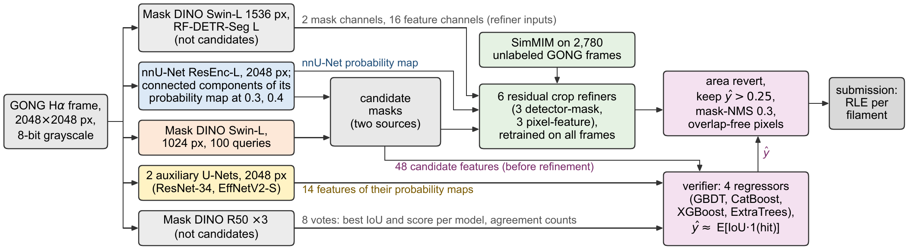

# Solar filament instance segmentation (GONG H-alpha, MAGFiLO)

Code, configuration files and trained weights of our solution to the Kaggle / IEEE BigData Cup 2026 challenge
[filament-segmentation-2026](https://www.kaggle.com/competitions/filament-segmentation-2026).

Author: Miki Kuronuma (Saitama University). GitHub `0122POND`, Kaggle `deepernet` and Hugging Face `bizyu` are accounts of the same author.

**What it does.** The input is one 2048 x 2048 grayscale GONG H-alpha frame. The output is one mask per solar filament
(run-length encoded, one CSV row each), and no two masks share a pixel. Two models propose candidate masks: the connected
components of an nnU-Net probability map and the instances of Mask DINO Swin-L. Six small U-Nets (the refiners) redraw
every candidate mask inside a crop around it. A selector (four tree-based regressors on 70 features) gives every
candidate a score, its expected IoU with a true filament. Candidates with a score above 0.25 are kept, and a decode step
removes duplicates and shared pixels.

Every model was trained by us on the 707 training frames of the competition. The starting weights are the public
pre-trained checkpoints listed in "License and citation" (COCO, ImageNet) and, for the refiners, an encoder that we
pre-trained without labels (SimMIM) on 2,780 unlabeled GONG frames. The final model uses no filament annotations other
than those of the competition training set.

**Final model.** In this repository "final model" means one thing: `configs/final_yellow.yaml`, the configuration that
produced our final submission (`outputs/sub_NLv_FF6CC0_t025_ORDp10.csv`, md5 `540c886326cff3320dd341c0dedd2cd1`, 1,209
filaments on 178 of the 180 test frames, public leaderboard 0.41). Every other config is an earlier or alternative pipeline and is
named as such ("Names used in this repository").

**Demo notebook.** `notebooks/demo.ipynb` goes through preprocessing, loading the trained weights (or training),
inference, post-processing and evaluation, and writes the submission CSV. It downloads what it needs by itself.

## Pipeline



```
GONG H-alpha frame, 2048 x 2048, one grey channel
  |- nnU-Net ResEnc-L 2D (2048 px) -> probability map -> connected components at 0.3 / 0.4 --.
  |- Mask DINO Swin-L (1024 px)    -> instances with score >= 0.05 --------------------------+-> candidates
  |- helper models, not candidate sources: U-Net++ (candidate features), Mask DINO R50 x 3 (votes), two auxiliary
  |  U-Nets at 2048 px (map features), Mask DINO Swin-L at 1536 px and RF-DETR-Seg L (inputs of the refiners)
  v
for every candidate:
  refiners   six residual crop U-Nets trained on all 707 frames, mean probability -> redrawn mask
             3 x detector-mask refiner (also reads the masks of the two extra detectors)
             3 x pixel-feature refiner (also reads pixel features of Mask DINO Swin-L 1536)
  selector   HistGradientBoosting / CatBoost / XGBoost / ExtraTrees on 70 features -> score y_hat
             (the "verifier" of the report)
  v
area revert: a Mask DINO candidate whose redrawn mask is below 0.6 x its original area keeps the original mask
  v
decode: keep y_hat > 0.25, place the candidates in decreasing y_hat (order bonus: + 0.10 for the Mask DINO candidates, in
        the order only), drop a candidate whose IoU with a placed one is above 0.3 (mask NMS), remove pixels that a
        placed mask already holds
  v
submission.csv  (filament_id, segmentation_rle)
```

The 180 test frames give 10,189 candidates, of which 1,209 are in the submission.

**Terms of the report and names in the code.** The report uses descriptive terms. The code, the configs and the file
names keep the short names of development. This table is all a reader needs to move between the two; the longer table
"Names used in this repository" explains every name.

| term in the report | name in this repository |
|---|---|
| verifier | selector, `NLv`, V-ENS (`filament_seg/nlv.py`, files `nlv/verifier_nlv_*`) |
| detector-mask refiner | `NNRP` |
| pixel-feature refiner | `S15F` |
| six-refiner ensemble | `B6` (`refiner.members` of the config) |
| seed mask | the candidate mask before the refiner |
| area revert | `C0` |
| order bonus | `decode.order_bonus` (`ORDp10` in file names: 0.10; `ORDp02`: 0.02) |
| auxiliary U-Nets, auxiliary maps | `own2` (ResNet-34 and EfficientNetV2-S U-Nets at 2048 px) |
| votes | Mask DINO R50 x 3 seeds, the eight features `v_*` (`filament_seg/votes.py`) |
| refiners retrained on all training frames | full-data, `fullfit`, `FF` in file names |
| final submission | `configs/final_yellow.yaml` ("yellow" is the colour with which Kaggle marks the best public score among one's submissions) |

## Results

The six refiners of the final model are trained on all 707 training frames, so no training frame is held out for them.
The out-of-fold (OOF) numbers below are those of the **fold version**: the same pipeline and decode with five-fold
refiners (refiner seeds none / 11 / 12; the seed 16-18 refiners of the final model have no fold version). Ground truth =
each annotator record separately, as in the organisers' self-evaluation notebook. Section 5 of `notebooks/demo.ipynb`
recomputes every number of this table from the stored out-of-fold outputs; the stored run printed these values.

| quantity of the scoring rubric | final model (fold version), 707 training frames, OOF | one annotator against another, 296 frames with two or three records |
|---|---|---|
| panoptic quality PQ (score threshold fixed at 0.25) | **0.4759** | 0.340 |
| segmentation quality SQ x recognition quality RQ | 0.688 x 0.691 | 0.634 x 0.536 |
| matched (IoU > 0.5) / unmatched predictions / unmatched ground truth | 5,464 / 2,144 / 2,735 | 4,292 / 3,709 / 3,709 |
| mean Dice per annotator record (torchmetrics `DiceScore`) | 0.674 | 0.614 |
| overlapping (ground truth, prediction) pairs: mean IoU / mean Dice | 0.616 / 0.745 (6,811 pairs) | 0.517 / 0.661 (6,862 pairs) |
| one-to-many: ground-truth filaments overlapped by two or more predictions | 2.3 % | 3.2 % |
| many-to-one: predictions that overlap two or more ground-truth filaments | 2.3 % | 3.2 % |
| ground-truth filaments that no prediction overlaps | 19.4 % | 17.8 % |
| predictions that overlap no ground-truth filament | 12.9 % | 17.8 % |

On the same 296 frames the PQ of the model is 0.474. With the threshold chosen on the other four folds ("nested") and
without the order bonus the PQ is 0.4753. The refiners raise the OOF PQ from 0.461 to 0.476.

| | value |
|---|---|
| public leaderboard (PQ on about half of the test frames, shown with two decimals) | **0.41** |
| inference cost per test frame | 34 GPU seconds in one end-to-end run on an RTX PRO 6000 (36 s wall-clock with the CPU stages; peak GPU memory 20 GB). On one RTX 4090 the per-stage timings sum to 43 GPU seconds: 105 forward passes of the candidate and helper models (37 s) and the six refiners (6 s) ("Inference cost") |
| a single model at lower cost, not adopted | one Mask2Former: 6.5 GPU seconds per frame on the same RTX PRO 6000 model, nested OOF PQ 0.4760 against 0.4753, public leaderboard 0.40 ("Accuracy against cost") |

**How the final model was chosen.** `configs/final_fullfit.yaml` is the same model with refiner seeds none / 11 / 12 and
without the order bonus of the decode (public leaderboard also 0.41). The final model differs from it in these two
settings only. Both are inside the noise of our validation: on the OOF frames the order bonus changes the PQ by
+0.0001, and other refiner seeds move it by a standard deviation of 0.0002 to 0.0005. We chose between them by the
order on the public leaderboard: the refiner seeds and an order bonus of 0.02 on 2026-11-14 (md5 `257bb97a...`), the
bonus of 0.10 on 2026-11-15, when it ranked above the 0.02 version (four other one-setting variants
submitted that day did not). We do not claim that the final model is better than `configs/final_fullfit.yaml`, and we
expect no gain on the private part from this choice.

## Quick start

`notebooks/demo.ipynb` is stored with the outputs of one complete run of its CPU path (macOS arm64, no GPU, 2 CPU
threads, 341 s): the CSV it wrote is byte-identical to the final submission (md5 `540c886326cff3320dd341c0dedd2cd1`).

```
git clone https://github.com/0122POND/solar-filament-seg && cd solar-filament-seg
python3.12 -m venv .venv && source .venv/bin/activate
pip install -r requirements-cpu.txt                                 # CPU path, any platform; GPU path: requirements.txt and "Setup"
python -m ipykernel install --sys-prefix --name solar-demo          # a kernel that is this environment
export SOLAR_DATA=/path/to/MAGFiLO_1.0_Kaggle_2026                  # train/ and test/ as downloaded from Kaggle
python -m nbconvert --to notebook --execute notebooks/demo.ipynb --output demo.out.ipynb \
    --ExecutePreprocessor.kernel_name=solar-demo --ExecutePreprocessor.timeout=3600
md5sum out/demo/submission.csv                                      # 540c886326cff3320dd341c0dedd2cd1  (macOS: md5 -q)
```

We ran exactly these steps on 2026-11-15 on a new clone in an empty virtual environment (macOS arm64, no GPU): the
notebook took 5 min 18 s and gave the same md5 and the out-of-fold PQ 0.4759 of "Results". The Hugging Face repository
was still private on that day, so the five files the notebook downloads (the stored outputs and the four selector
files) were copied into `weights/` before the run. Name the kernel as above: with the default kernel name
`python3`, Jupyter may start another Python installation that lacks the pinned packages.
While the Hugging Face repository below is public the download needs no account; `SOLAR_DATA` is needed by section 1
(figures of the input) and section 5 (evaluation on the training frames), not by the CSV itself: `final-cpu` on the
stored outputs with `SOLAR_DATA` set to a missing folder wrote the same md5.

**Weights.** The trained weights are too large for Git (63 files, 17.3 GB for the final model; the largest is 895 MB).
They are stored in our public Hugging Face model repository
[`bizyu/solar-filament-seg`](https://huggingface.co/bizyu/solar-filament-seg) (no login). The notebook downloads the
files it needs and checks the size and sha256 of each one against `weights/MANIFEST_final.tsv`. There is no manual step.

**CPU path (no GPU found; about 5 min).** The notebook downloads the stored outputs of the GPU stages of the submitted
run (`cache/final_cache_v1.tar`, 157 MB, listed in `weights/MANIFEST_cache.tsv`; no images and no annotation polygons inside)
and the four selector files (39 MB). It then runs everything after the GPU stages: selector scores, C0, decode, the
CSV checks, and the evaluation of section 5. This path reproduces the final submission byte for byte. The same from the
command line, after the notebook has downloaded the files:

```
export SOLAR_ROOT=$PWD/out/demo/cache
python -m filament_seg --config configs/final_yellow.yaml final-cpu --load-weights weights/nlv --out final.csv   # selector + C0 + decode, about 3 min
python -m filament_seg --config configs/final_yellow.yaml final-cpu --yhat-cached --out final.csv               # C0 + decode from the stored scores
md5sum final.csv                                                                                                # 540c886326cff3320dd341c0dedd2cd1
```

**GPU path (a CUDA GPU with 24 GB).** With a GPU the notebook downloads the 63 weight files and runs every model on the
raw test frames. We ran these stages from the command line, in three Python environments ("Setup"), not from the
notebook: the GPU cells of the stored notebook were not executed, and we have not tested Mask DINO, nnU-Net and RF-DETR
in one kernel. If the packages conflict, use the commands of "Final model: stages, commands and checks". A fresh GPU run
gives the same filaments up to a few boundary pixels and a few candidates near the threshold, not the same bytes
("End-to-end run from the raw test frames").

**Tests.** `pytest` runs the unit tests on a fresh clone without data (44 passed, 41 skipped in the CPU environment above;
52 passed, 33 skipped with `requirements.txt`). The skipped tests need the packages of the GPU path or compare with the
submitted runs and need files that are not in Git; `pytest -rs` prints the reason for each one. With `SOLAR_ROOT` set as
above, `pytest tests/test_golden_yellow.py` checks the final CSV (five of its seven tests run; "Tests").

## Names used in this repository

| name | meaning |
|---|---|
| **final model** | `configs/final_yellow.yaml`: the configuration of the final submission. Nothing else is called "final model" |
| **fold version** | the final model with five-fold refiners instead of the full-data ones; the version that has OOF numbers |
| **full-data**, `fullfit` | a refiner trained on all 707 training frames (`residual --fold -1`) and applied to the five fold-specific inputs at test time. `configs/final_fullfit.yaml` is the final model with refiner seeds none / 11 / 12 and without the order bonus (public leaderboard 0.41) |
| **candidate** | one proposed filament mask, from the nnU-Net components or from Mask DINO Swin-L |
| **NLv**, **selector**, **verifier**, **V-ENS** | the selector of the final model: four regressors (HistGradientBoosting, CatBoost, XGBoost, ExtraTrees) on 70 candidate features, combined by a rank average. The code and the older sections call it verifier or V-ENS. `filament_seg/nlv.py` |
| **NNRP** | a refiner that reads, besides the frame, the candidate and the nnU-Net map, the best-overlapping masks of Mask DINO Swin-L 1536 and RF-DETR-Seg L (9 input channels) |
| **S15F** | an NNRP refiner that also reads 16 feature channels of the Mask DINO Swin-L 1536 pixel decoder |
| **B6** | the refiner ensemble of the final model: three NNRP and three S15F members (different random seeds), equal-weight mean of their probabilities |
| **C0** | a rule after the refiner: a Mask DINO candidate whose redrawn mask has less than 0.6 of its original area keeps the original mask ("area revert" in the report and in the figure above) |
| **tau** | the score threshold of the decode (0.25 in the final model) |
| **order bonus** | `decode.order_bonus: 0.10`: for the order of the decode only, 0.10 is added to the score of the Mask DINO candidates. The test "score > tau" uses the unchanged score |
| **OOF**, out-of-fold | a training frame is predicted by models that did not see it (5 folds) |
| **PQ**, **rec PQ**, **simulated PQ** | panoptic quality, the matching-based score of the competition. rec = against the annotator records as they are. simulated = after each ground-truth filament is dropped with probability 0.23 (5 draws), a rate calibrated on the public leaderboard scores of our earlier submissions |
| **STK** | an alternative selector (`configs/stk.yaml`): NLv with a fourth voter and seven agreement / shape columns (80 features), averaged over five seeds. Better OOF, public leaderboard 0.40; not used by the final model |
| `yolo`, `v1_b03`, `v1_b04` | candidate-source labels kept from the base pipeline, because the stored tables use them. In the final model `yolo` = Mask DINO Swin-L instances, `v1_b03` / `v1_b04` = nnU-Net components at 0.3 / 0.4. The final model runs no YOLO model |
| `nlv/`, `final/`, `fullfit/`, `cache/` on the Hub | folder names kept from development. `nlv/` = candidate models, voters and selector of the final model; `fullfit/` = full-data refiners (seeds 16-18: the final model); `final/` = models added for STK, of which the final model uses Mask DINO Swin-L 1536, RF-DETR-Seg and `s15f_align.npz`; `cache/` = the stored outputs for the CPU path |

Other configs, kept so that their results can be reproduced: `configs/final_fullfit.yaml` (above),
`configs/stk.yaml` with `configs/s15f.yaml`, and `configs/stk_nnrp.yaml` (STK alternative, public leaderboard 0.40),
`configs/nlv.yaml` (minimal variant NLv + NNR, 0.40), `configs/champion.yaml` (base pipeline with YOLO11 candidates, 0.39)
and `configs/a2_refined.yaml` (an earlier variant of the base pipeline, 0.38).

The rest of this file gives the details: the comparison of the variants, the weights, the stages and commands of the
final model with their checks, the end-to-end run, the inference cost, the alternatives, the base pipeline, data, setup,
tests, the decision log, reproducibility notes and licences.

## Comparison of the variants

| | 707-frame 5-fold OOF PQ (tau 0.28) | simulated test PQ | public LB |
|---|---|---|---|
| **final model: NLv x full-data B6 + C0, order bonus 0.10** (`configs/final_yellow.yaml`, tau 0.25) | 0.4759 of the fold version with the bonus (nested 0.4753 without it) | 0.4144 | **0.41** |
| the same with refiner seeds none / 11 / 12 and no order bonus (`configs/final_fullfit.yaml`, tau 0.25) | 0.4758 (nested 0.4753) of the fold version | 0.4142 | 0.41 |
| NLv x B6 + C0, fold refiners (tau 0.25) | 0.4758 (nested 0.4753) | 0.4142 | 0.41 |
| STK-avg5 + C0 + S15F (`configs/stk.yaml`) | **0.4767** (nested 0.4759) | 0.4171 | 0.40 |
| STK-avg5 + C0 + NNRP (`configs/stk_nnrp.yaml`) | 0.4748 (nested 0.4741) | 0.4155 | 0.40 |
| STK-avg5 with NNR masks | 0.4732 (nested 0.4724) | 0.4140 | 0.40 |
| minimal variant NLv + NNR (`configs/nlv.yaml`) | 0.4701 | 0.4116 | 0.40 |
| base pipeline (`configs/champion.yaml`) | 0.4473 | - | 0.39 |
| annotator vs annotator on the same frames | 0.34 | - | - |

Values of Table 1 of the report that can be found in this repository: 0.4224 (first row; nested value of the 0.4230 at fixed tau) and 0.4527 (second row) in
`docs/decisions.tsv` (2026-10-05, 2026-11-02); the nested values of the table above for `+ nnU-Net map channel, area revert`,
ext. 0.4724 = "STK-avg5 with NNR masks"; `+ detector-mask channels`, ext. 0.4741 = `configs/stk_nnrp.yaml`;
`+ Swin-L pixel features`, ext. 0.4759 = `configs/stk.yaml`; `3 + 3 refiners`, base 0.4753 = "NLv x B6 + C0, fold refiners";
final = `configs/final_yellow.yaml`. The other values of that table come from development runs that this repository does
not reproduce.

"Simulated test PQ" is the OOF PQ after each GT filament is dropped with probability 0.23 (5 draws). This keep rate
was calibrated on the public LB of our earlier submissions. The report explains the gap between OOF and LB.
The full-data refiners have no held-out frames, and the seed 16-18 members have no fold version, so the OOF numbers of
the final model are those of the fold version with refiner seeds none / 11 / 12 (same selector, recipe and decode).

## Weights

The trained weights are too large for Git (63 files, 17.3 GB for the final model; the largest is 895 MB and GitHub
accepts at most 100 MB per file). They are stored in the public Hugging Face model repository
`bizyu/solar-filament-seg` (no login), and the demo notebook `notebooks/demo.ipynb` downloads them and checks their
sha256 by itself (section 2, `fetch`): there is no manual step.

`weights/MANIFEST_final.tsv` lists every file of the final model, of `configs/final_fullfit.yaml`, of STK-avg5 + C0 + S15F,
of its slim variant and of NLv + NNR (115 files, 22 GB): path, role, pipelines that use it (`variants`: `final` = the final
model `configs/final_yellow.yaml`, `fullfit_a` = the six refiners of `configs/final_fullfit.yaml`, `stk` = STK-avg5 + C0 +
S15F, `ore`, `nlv`), size, sha256 (md5 where already published), licence, and the download URL
`https://huggingface.co/bizyu/solar-filament-seg/resolve/main/<file>` (`HF_REPO=bizyu/solar-filament-seg`).
`weights/MANIFEST_cache.tsv` lists, in the same format, the one archive of stored model outputs that the CPU path of the
notebook reads (`cache/final_cache_v1.tar`, 157 MB, 2,731 files: outputs of our models on the test frames and out-of-fold
outputs on the training frames; no image and no annotation polygon; the out-of-fold candidate table carries, for each candidate, its IoU with the annotator records (the training target of the selector)).
The model card of the Hub repository is `weights/HF_MODEL_CARD.md`; `tools/hf_stage_upload.sh` is the upload script
(streams each file, checks its sha256, uploads, `verify` compares the Hub's LFS sha256 with the manifest).

The final model does not need the Kaggle Dataset below; it is a second copy of the NLv files only and needs a Kaggle login:
[`deepernet/solar-filament-nlv-weights`](https://www.kaggle.com/datasets/deepernet/solar-filament-nlv-weights)
(`weights/MANIFEST_nlv.tsv`, `md5sum -c MD5SUMS.txt`).

```
kaggle datasets download -d deepernet/solar-filament-nlv-weights -p weights --unzip
```

## Final model: stages, commands and checks

`configs/final_yellow.yaml` (includes `configs/final_fullfit.yaml`, which includes `configs/stk.yaml` for the refiner planes and
features):

| stage | what | module |
|---|---|---|
| candidates, votes, map features, verifier | NLv exactly as in "Minimal variant (NLv + NNR)" below: nnU-Net + Swin-L 1024 candidates, R50 seeds 0-2 votes, own2 map features, V-ENS on 70 features (one seed) | `filament_seg/nlv.py` |
| refiner | B6 = six members, equal-weight probability mean: NNRP (9 planes) and S15F (9 planes + Swin-L 1536 features at stride 4), three seeds each (x16, x17, x18; `configs/final_fullfit.yaml` uses no seed, x11, x12), recipes of `configs/stk_nnrp.yaml` / `configs/s15f.yaml`. Each member is **retrained on the crops of all 707 frames** (`residual --fold -1 --member <tag>`, 39,314 rows instead of about 31,500, no held-out rows; inputs are the same OOF crops / planes / features as the fold models) | `refiner.train_residual`, `stages.stage_residual`, `stages.residual_rows` |
| test-time refiner | each full-data refiner is applied to the five fold-k inputs (nnU-Net map, NNRP planes and S15F features of fold model k), flip TTA x 4, and the five probabilities are averaged, as for five fold models; mean over the six members = sum / (5 x 6) | `refiner.ensemble_members` (member `full: true`), `nlv.refiner_members`, `nlv.refine_test` |
| C0, decode | C0 (ratio 0.6), tau 0.25, order bonus 0.10 (for the processing order only, 0.10 is added to the score of the Mask DINO Swin-L candidates; acceptance uses the unchanged score), mask NMS 0.3, no overlaps | `nlv.apply_c0`, `nlv.decode`, `nlv.DECODE_KNOBS` |

| number | value |
|---|---|
| public LB | **0.41** (also 0.41: seeds none / 11 / 12 without the bonus, and the fold version NLv x B6 + C0) |
| OOF of the fold version (707 frames) | nested 0.4753 / rec tau 0.25 0.4758 / simulated 0.4142 (`oof-eval`); with the order bonus rec 0.4759 / simulated 0.4144 |
| final CSV | `outputs/sub_NLv_FF6CC0_t025_ORDp10.csv` (in this repository), md5 `540c886326cff3320dd341c0dedd2cd1`, 1,209 filaments on 178 frames. Without the bonus: 1,210 filaments, md5 `678c248214a5a61210c7fe1c6fd0e65b`, 914 masks reset by C0; the bonus changes 164 of the 178 frames. With a bonus of 0.02 (our best public submission until 2026-11-14): `sub_NLv_FF6CC0_t025_ORDp02.csv`, 1,209 filaments, md5 `257bb97ad9cbe854007832b9725a3cff`; 146 of the 178 frames differ from the final CSV |
| CSV of `configs/final_fullfit.yaml` | `sub_NLv_FF6C0_t025.csv`, md5 `31e0708424a321eb19d996a2a2868dcf`, 1,210 filaments on 178 frames (950 masks reset by C0) |
| seeds 16-18 vs seeds none / 11 / 12 on the test (both without the bonus) | same 1,210 selected candidates; matched mask IoU mean 0.987 |
| full-data (seeds none / 11 / 12) vs fold refiners on the test | same 1,210 selected candidates; matched mask IoU mean 0.986 (median 0.989); total area x 0.997 |

**Why only the refiner is retrained on all frames.** The refiner is the last model in the chain: its inputs (crops, planes,
features) are OOF outputs both in training and at test time, so retraining it on all frames only adds 25 % training rows.
We also tried retraining the candidate side (Swin-L 1024, nnU-Net, R50 voters) on all frames ("fullcand", with the same
full-data refiners): public LB 0.40, below 0.41. The selector and the refiner were trained on OOF outputs of fold models, and
the full-data candidate models move their inputs away from that distribution. The full-data step therefore stops at the
refiner. The public LB is shown with two decimals and covers half of the test set: 0.41 for both the fold and the full-data
refiners does not separate them, and the OOF cannot (no held-out frames). We keep the full-data version as the final model
because its public score was the higher one in the leaderboard ranking (difference below 0.005).
Among the full-data variants that our validation cannot separate (refiner seeds, order of the decode), the final model is
the one the public leaderboard ranks highest. We do not claim that it is better than `configs/final_fullfit.yaml`.

No stage-1 refiner is trained for the final model: on its candidate table the two stage-1 terms of the sampling weight
(`refiner.residual_weights`) are zero.

Commands (GPU unless noted; the inputs are those of `configs/stk.yaml`: refiner crops, `nlv.stage_nnr_crops`,
`nnrp-planes`, S15F feature crops):

```
for m in FFNNRPx16 FFNNRPx17 FFNNRPx18 FFS15Fx16 FFS15Fx17 FFS15Fx18; do
  python -m filament_seg --config configs/final_yellow.yaml residual --fold -1 --member $m   # out/refiner_$m_f-1.pt (1 h 45 min; six in parallel on one RTX 5090)
done
python -m filament_seg --config configs/final_yellow.yaml detect-test --model swinl1024 --weights weights --out out   # candidates: frame i by fold model i % 5
python -m filament_seg --config configs/final_yellow.yaml detect-test --model r50 --weights weights --out out         # voters, seeds 0-2: frame i by fold model i % 5
python -m filament_seg --config configs/final_yellow.yaml detect-test --model swinl1536 --weights weights --out out   # refiner planes: every fold model on every frame
python -m filament_seg --config configs/final_yellow.yaml s15f-test                         # fold-k test feature crops
python -m filament_seg --config configs/final_yellow.yaml refine-test --weights weights --out refined.pkl
# CPU
python -m filament_seg --config configs/final_yellow.yaml final-cpu --out final.csv                      # selector refitted + C0 + decode (4 min; the refit was checked with configs/final_fullfit.yaml)
python -m filament_seg --config configs/final_yellow.yaml final-cpu --load-weights weights/nlv --out final.csv   # saved selector files (3 min)
python -m filament_seg --config configs/final_yellow.yaml final-cpu --yhat-cached --out final.csv        # C0 + decode from the stored scores (under 1 min)
python -m filament_seg --config configs/final_yellow.yaml oof-eval                                       # fold version with the order bonus, tau 0.25 (50 s)
```

The block above lists the stages that are subcommands of `python -m filament_seg` with this config. The earlier test-time
stages are listed in "Stage order" of "Minimal variant (NLv + NNR)" and run in the environments of "Setup": U-Net++
(`semantic.predict`), nnU-Net maps (`nnunet_cands.predict_maps`), own2 maps (`own-maps --mode testfold`), RF-DETR-Seg
(`python -m filament_seg.rfdetr_cands`) and the candidate table (`nlv.candidates_image`). Sections 3.1 to 3.5 of
`notebooks/demo.ipynb` show these calls with their arguments; its GPU branches were not executed in one kernel (first cell
of the notebook).

| check (`tests/test_golden_yellow.py`, `tests/test_decode_knobs.py`, `tests/test_golden_final.py`, `tests/test_fullfit_units.py`; macOS arm64) | result |
|---|---|
| decode of the stored NLv scores + test masks of the six seed 16-18 members, C0 and the order bonus applied in the repository | byte-identical to 540c8863; with `decode.order_bonus: 0.02` byte-identical to 257bb97a, with `decode.order_bonus: 0` to 678c2482 (914 masks reset by C0) |
| `final-cpu --load-weights` with the saved selector files, reading only the stored outputs of `cache/final_cache_v1.tar` (test votes and map features rebuilt, 3.2 min) | CSV byte-identical to 540c8863 |
| `configs/final_fullfit.yaml`: decode of the stored NLv scores + full-data B6 test masks (seeds none / 11 / 12), C0 applied in the repository | byte-identical to 31e07084 (950 masks reset by C0) |
| `configs/final_fullfit.yaml`: `final-cpu --load-weights` with the saved NLv members (test votes and map features rebuilt) | scores identical (max abs diff 0), CSV byte-identical |
| `configs/final_fullfit.yaml`: `final-cpu`, V-ENS refitted on the OOF table (`GOLDEN_FINAL_FULL=1`) | scores identical, CSV byte-identical |
| `oof-eval` (NLv OOF scores x B6 fold-refiner OOF masks, C0, tau 0.25) | rec 0.4759 / simulated 0.4144 with the order bonus (`configs/final_yellow.yaml`), 0.4758 / 0.4142 without (`configs/final_fullfit.yaml`) |
| `configs/final_fullfit.yaml`: member mean + paste-back of the repository (`nlv.member_sum_mean`, `nlv.paste_refined`) on the per-member test probability sums of the development run (6 x 10,189 candidates, CPU) | 10,189 / 10,189 refined masks identical; the pickle is byte-identical (md5 d67c36ca) to the one the CSV 31e07084 was built from |
| full-data member = mean of one checkpoint over the five fold inputs; member mean = sum / (K x M) (synthetic, CPU) | exact |
| `notebooks/demo.ipynb` with `PIPELINE = "final"` (macOS arm64, no GPU, 2 CPU threads; stored outputs of `cache/final_cache_v1.tar`, saved selector files; the outputs of this run are stored in the notebook) | CSV byte-identical to 540c8863 (scores max abs diff 0 against the stored ones, 914 masks reset by C0), `oof-eval` rec 0.4759 / simulated 0.4144, the rubric numbers of "Results"; 341 s |
| `refine-test` with the six seed 16-18 members (`configs/final_yellow.yaml`, each full-data refiner x 5 fold-k inputs, all 10,189 test candidates / 180 frames, GTX 1080 Ti, 58 min) | the pickle is byte-identical (md5 23346b75) to the one the final CSV was built from; C0 + decode -> CSV byte-identical to 540c8863 |
| `configs/final_fullfit.yaml`: `refine-test` with its six full-data members (each full-data refiner x 5 fold-k inputs, all 10,189 test candidates / 180 frames, GTX 1080 Ti, 57 min) | 10,189 / 10,189 refined masks identical; the pickle is byte-identical (md5 d67c36ca); C0 (950 reset, C0 masks identical) + decode with NLv tau 0.25 -> CSV byte-identical to 31e07084 |

Not run in this repository: the full-data training itself (`residual --fold -1`, ported from the development script
`refiner_full.py` = the fold script plus `--fold -1`; training is not bit-reproducible), and the refit of the selector with
`configs/final_yellow.yaml` (the refit was checked with `configs/final_fullfit.yaml`, which has the same selector). The test
side of the six full-data members (`refine-test` on the GPU) was run from the repository and reproduces the final CSV
(table above).

`detect-test` writes `maskdino_test_swinl_f{k}.pkl`, `maskdino_test_s{0,1,2}_f{k}.pkl` and `maskdino_test_swinl1536_f{k}.pkl`
(needs `MASKDINO_ROOT`). The candidates and the votes of test frame i read only fold model i % 5, so for `swinl1024` and `r50`
each fold model predicts its 36 of the 180 frames (1 instead of 5 forward passes per frame and model family; same candidate
table and votes). `--all-folds` restores every fold model on every frame, which only the g7_m2 columns of `configs/stk.yaml`
need. `notebooks/demo.ipynb` does the same with `ALL_FOLDS` (False for `PIPELINE = "final"` / `"fullfit_a"`, True for `"stk"`).

### Demo notebook (`notebooks/demo.ipynb`)

| section | content |
|---|---|
| setup, download | flags (`PIPELINE`, `RUN_GPU_STAGES`, `TRAIN_FROM_SCRATCH`, `TRAIN`, `EVAL_FRAMES`), paths, `fetch`: download from the Hub with size and sha256 checks |
| 1 preprocessing | frames as one grey channel, the 3-channel network input (figure), annotation polygons -> masks |
| 2 training or loading | default: the trained weights are downloaded and checked. `TRAIN_FROM_SCRATCH = True` runs the training commands of the stages selected in `TRAIN` |
| 3 inference | GPU: every model on the test frames. CPU: their stored outputs are read |
| 4 post-processing | selector scores, C0, decode -> `submission.csv`; md5, row count and scores compared with the submitted run |
| 5 evaluation | `oof-eval` and the rubric numbers of "Results" on the out-of-fold training frames (figure) |

`PIPELINE = "final"` (default) runs `configs/final_yellow.yaml`; `"fullfit_a"` and `"stk"` run `configs/final_fullfit.yaml`
and `configs/stk.yaml`, whose stored outputs are not in the archive of the CPU path (set `SOLAR_ROOT` to a folder that has
them, or use the GPU path). Paths: `SOLAR_DATA` (competition data), `SOLAR_WEIGHTS` (default `weights/`), `SOLAR_OUT`
(default `out/demo`; the archive is unpacked to `out/demo/cache`).

What the stored run covers (macOS arm64, no GPU, 341 s; the first markdown cell of the notebook says the same):
the CPU path was executed and gave the final CSV byte for byte. The GPU branches were not executed in the notebook; the
same stages were run from the command line (table above and "End-to-end run"). The download function ran with the files
already in place (sizes and sha256 verified), so the HTTP transfer itself is not part of the stored run. The training
cells were not run.

### End-to-end run from the raw test frames

Two such runs exist. The first, described in the table below, was made with `configs/final_fullfit.yaml` (refiner seeds
none / 11 / 12, no order bonus; CSV 31e07084) before the final model was fixed, on the software of the submitted run.

The second was made with `configs/final_yellow.yaml`, the final model, on 2026-11-14/15: one uninterrupted chain of all
stages from the 180 JPEG frames on one RTX PRO 6000 Blackwell (the code of 2026-11-14, published weights checked by sha256).
This GPU needs CUDA 12.8 builds, so the packages are newer than the pinned ones (torch 2.7.1 + cu128, rfdetr 1.12.0,
numpy 2.5 / pandas 3.0 in the CPU environment; scikit-learn, CatBoost and XGBoost as pinned). Result: 10,190 candidates
(submitted run 10,189). The chain ran with the order bonus of that day, 0.02 (CSV of 1,207 filaments, md5 `cdcb378f...`).
On 2026-11-15 we repeated its last stage (selector, C0, decode; CPU, 3.8 min) on the stored outputs of the chain with the
final order bonus 0.10: a CSV of 1,207 filaments on 178 frames (md5 `7787446c...`, **not byte-identical** to the final
submission, as expected with other builds). 1,207 of the 1,209 submitted filaments have a partner at IoU >= 0.9 in it
(mean IoU 0.9989), 584 masks are identical, and the Dice of the two pixel unions is 0.997. The timings of the chain are
in "Inference cost". Neither CSV was submitted.

One fresh run of every test-time stage from the 180 JPEG frames with the code of this repository and the published weights,
on one RTX 4090 (Linux, torch 2.6.0 + CUDA 12.4), compared with the CSV of that configuration (31e07084). The stages were run one after
another in the three environments of "Setup": the commands above for the S15F features, the refiner and
`final-cpu --load-weights`; the module functions for U-Net++, nnU-Net, Mask DINO, own2, RF-DETR and the candidate table
(`detect-test` was added afterwards; its 5 Swin-L 1024 and 15 R50 files and the candidate table built from them are
byte-identical to those of this run, as are the files of the notebook's `all_folds` with `ALL_FOLDS = False`).

| check | result |
|---|---|
| fresh CSV | 1,208 filaments on 178 frames, md5 `0a05d16cf4d95ac12c5e4c02cc63e5a2` (reference: 1,210 on 178). **Not byte-identical** |
| filaments, one-to-one match with the reference CSV | 1,206 at IoU >= 0.5, all of them at IoU >= 0.9; 1,184 at IoU >= 0.99; 1,057 identical masks |
| candidates | 10,189 = 10,189; 9,470 identical masks, 10,158 at IoU >= 0.99 |
| V-ENS scores (candidates matched by mask) | max abs diff 0.094; 19 candidates change side at tau 0.25 |
| RF-DETR-Seg, 5 fold models | byte-identical to the submitted run |
| Mask DINO Swin-L 1024 / Swin-L 1536 instances | 6,641 / 6,641 and 34,426 / 34,428 at IoU >= 0.99 |
| nnU-Net maps, own2 maps, U-Net++ probability | 0.014 % and 0.011-0.015 % of the pixels differ (a second run on the same machine: 0.015 %); max abs diff 0.017 |
| Mask DINO R50 voters (seeds 0-2) | 96-97 % of the instances at IoU >= 0.99, 41-43 % identical |
| same run with the R50 voter outputs of the submitted run | 4 candidates change side (instead of 19), score max abs diff 0.019 |
| `final-cpu --load-weights` on macOS arm64 and on Linux x86-64, same inputs | same CSV (same md5) |
| all cached outputs of the submitted run + `final-cpu --load-weights` | byte-identical to 31e07084 |

So a fresh GPU run gives the same filaments up to a few boundary pixels, except for candidates near the threshold: 2 fresh
filaments have no partner in the reference CSV and 4 reference ones have none in the fresh CSV. The main source of the
difference is the R50 voters: on this machine their masks differ slightly from those of the submitted run (two runs on
the same machine are byte-identical; in "GPU stages vs the submitted run" below, on another GPU, seed 0 was identical to the
submitted run on 6 frames). The dense maps (nnU-Net, own2) differ at rounding level, as described there.
Not checked: the V-ENS refit in this run (the saved members were used), a single-process notebook run, and the leaderboard
score of the fresh CSV (it was not submitted).

### Inference cost (180 test frames)

**One end-to-end run (RTX PRO 6000 Blackwell, final model).** Wall-clock time of each stage call of the second run of
"End-to-end run", model loading and file I/O included, nothing else on the GPU, 4 CPU threads:

| stage | wall-clock, 180 frames | per frame |
|---|---|---|
| U-Net++ | 11 s | 0.06 s |
| nnU-Net ResEnc-L, five fold models | 861 s | 4.78 s |
| Mask DINO Swin-L 1024 | 140 s | 0.78 s |
| Mask DINO R50 seeds 0-2 | 253 s | 1.41 s |
| Mask DINO Swin-L 1536 instances, five fold models | 1,041 s | 5.78 s |
| RF-DETR-Seg Large, five fold models | 1,609 s | 8.94 s |
| auxiliary U-Nets (own2 maps) | 375 s | 2.08 s |
| pixel features for the refiners (`s15f-test`) | 1,139 s | 6.33 s |
| six refiners (`refine-test`, with the CPU paste-back) | 736 s | 4.09 s |
| **GPU stages** | **6,163 s** | **34.2 s** |
| candidate table (CPU, 4 workers; 1.93 CPU seconds per frame) | 89 s | 0.49 s |
| `final-cpu --load-weights` (CPU) | 231 s | 1.28 s |
| **whole chain** | **6,483 s (1 h 48 min)** | **36.0 s** |

Peak GPU memory 20.0 GB (`nvidia-smi`, Swin-L 1536). The single Mask2Former of "Accuracy against cost" was timed on the
same GPU model (6.5 s per frame).

**Per-stage timings (RTX 4090).**

GPU seconds per test frame, nothing else running on the GPU. "before" is the code of the end-to-end run above: every
Mask DINO query mask was copied to the CPU before the score filter, and every RF-DETR tile mask was resized and encoded.
"now" selects and binarises the Mask DINO masks on the GPU (`maskdino_cands.predict`) and skips RF-DETR tile masks below
the score threshold (`rfdetr_cands`). The outputs are byte-identical before and now for all 30 files (Swin-L 1536 x 5,
RF-DETR x 5, Swin-L 1024 x 5, R50 x 15; all 180 frames).

| stage | forward passes per frame | before | now |
|---|---|---|---|
| U-Net++ (1024 px) | 1 | 0.05 | 0.05 |
| nnU-Net ResEnc-L, five fold models | 5 | 7.9 | 7.9 |
| Mask DINO Swin-L 1024 (frame i: fold model i % 5) | 1 | 1.54 | 0.93 |
| Mask DINO R50 seeds 0-2 (frame i: fold model i % 5) | 3 | 3.7 | 1.93 |
| own2 maps (2 models x 5 folds x 8 flips / rotations) | 80 | 2.63 | 2.63 |
| Mask DINO Swin-L 1536 instances, five fold models | 5 | 9.7 | 6.53 |
| S15F features (Swin-L 1536), five fold models | 5 | 6.4 | 6.4 |
| RF-DETR-Seg Large, five fold models (4 tiles each) | 5 | 34.7 | 10.54 |
| B6 refiner (`refine-test`: 6 members x 5 fold inputs x 4 flips per candidate; includes 1.6 s CPU paste-back) | - | 6.0 | 6.0 |
| **total** | 105 + refiner | **72.6** | **42.9** |

Peak GPU memory 20.2 GB (`nvidia-smi`; Swin-L 1536, 14.8 GB allocated by torch). CPU stages: candidate table 1.8 CPU
seconds per frame, `final-cpu --load-weights` 1.2-1.4 s per frame.
How it was measured: every stage was timed separately over all 180 frames, and the totals are the sums of these
per-stage measurements, not one end-to-end run. U-Net++, Mask DINO, own2 and RF-DETR: the inference loop without model
loading (2-13 s per model); nnU-Net, S15F features and refiner: the whole call. In the "before" column, nnU-Net,
Swin-L 1536 and RF-DETR are 5 x the time of fold model 0; in the "now" column all five fold models of Swin-L 1536 and
RF-DETR were timed (1.28-1.32 and 1.89-2.33 s per frame and model).
The whole `detect-test` calls, model loading included, took 173 s for `swinl1024` and 362 s for `r50` (0.96 and 2.01 s per
frame; peak 14.7 and 11.2 GB), which makes the total 43.0 s.
With `--all-folds` for Swin-L 1024 and R50 (20 instead of 4 passes) the total would be about 54 s (estimate from the
per-pass times). The Swin-L 1536 forward pass is run twice (instances and S15F features); sharing it would save at most
6.4 s per frame (not implemented).

### Accuracy against cost: a single model that we did not adopt

After the pipeline of the final model was fixed we trained one Mask2Former (Swin-T and Swin-L, native 2048 px) whose class output regresses
the target of the verifier (the expected TP-IoU of a mask over the annotator records), and fused three scales x eight
flips / rotations at test time. It needs no candidate table, no selector and no refiner. The idea of a single
query-based model came from approaches that were discussed publicly during the competition; the implementation is ours.
Its code is not part of this repository, because the final model does not use it.

| model | nested OOF PQ (707 frames) | GPU seconds per test frame | public LB |
|---|---|---|---|
| final model (this repository; OOF of the fold version) | 0.4753 | 34.2 (RTX PRO 6000, one end-to-end run); 42.9 (RTX 4090, sum of per-stage timings) | **0.41** |
| single Mask2Former Swin-L, 24 views | 0.4760 | 6.5 (RTX PRO 6000, the same model of GPU; peak 19.4 GB) | 0.40 |
| Mask2Former Swin-T, 24 views, followed by the B6 refiners | 0.4755 | 43.0 (RTX 4090) | 0.40 |

On the OOF frames the single Swin-L model is not separable from the final model (+0.0007, 5-95 % interval -0.0029 to
+0.0042) at about one fifth of the GPU time (34.2 against 6.5 s per frame on the same model of GPU; the 34.2 s include
model loading).
On the public LB it scored 0.40 with full-data weights and with fold weights, and so did the refined version and a rule
that combines both pipelines (OOF +0.0026 to +0.0035). The refined version saves nothing, because the refiner inputs
still need U-Net++, nnU-Net, Swin-L 1536 and RF-DETR. As an extra candidate source or vote for the final model the
single model changed the OOF PQ by -0.0045 to +0.0015: 99.4 % of the Swin-T instances overlap an existing candidate at
IoU >= 0.5. We kept the final model because it is the only family that reached 0.41 on the public LB, and accept the
higher cost.

Variants with the same selector all scored 0.41 on the public LB: 12 or 18 full-data refiners instead of six (the same
1,210 outputs, mean mask IoU 0.994 and 0.993 against the CSV of `configs/final_fullfit.yaml`), five submissions with
distilled refiners, six refiners with an nnU-Net ResEnc-XL map as an extra input plane (OOF -0.0008 on two folds), other
refiner seeds and other decode settings. The final model (`configs/final_yellow.yaml`) is the one of these that the
leaderboard ranks highest; our validation does not separate them.

## Alternative: STK-avg5 + C0 + S15F (`configs/stk.yaml`)

STK-avg5 + C0 + S15F was our selected submission until 2026-11-09 (public LB 0.40; best OOF). It is NLv + NNR (next section)
with five additions, all switched on by `configs/stk.yaml`:

| addition | what | module |
|---|---|---|
| 4th voter | Mask DINO Swin-L at 1536 px (5 folds, not a candidate source): `v_sl_iou`, `v_sl_sc`, `v_agree4` (11 vote features) | `filament_seg/votes.py` (`VOTERS_STK`) |
| g7_m2 columns | 7 agreement / shape columns: Swin-L 1024 duplicate queries, family agreement of R50 seeds 0-3 / Swin-L 1536 / Cascade Mask R-CNN R50-FPN / RF-DETR-Seg L, nnU-Net map beyond the skeleton tips, containment in an nnU-Net component | `filament_seg/evofeats.py`, `cascade_cands.py`, `rfdetr_cands.py` |
| V-ENS x 5 seeds | the four members fitted with seeds 0-4 on 80 features; the five test scores are averaged | `nlv.fit_members(seed=)`, `verifier.seeds` |
| S15F refiner | NNRP planes (NNR plus the best-matching Swin-L 1536 / RF-DETR-Seg mask, IoU >= 0.3, else empty; 9 input channels) plus the Swin-L 1536 pixel-decoder `mask_features` mapped into one 16-channel space shared by the five fold models (PCA16 of 125 reference frames + ridge per model, no labels), cropped 64 x 64 with the refiner window and added to the stride-4 encoder stage through a zero-initialised 1x1 conv | `filament_seg/s15f.py`, `refiner.py`, `refplanes.py`, `nlv.refine_test` |
| C0 | a Swin-L candidate whose refined mask is < 0.6 x its raw area keeps the raw mask (OOF and test) | `nlv.apply_c0`, `refiner.c0_ratio` |

| number | value |
|---|---|
| OOF nested PQ (tau chosen on the other 4 folds) | 0.4759 (NNRP 0.4741, NNR 0.4724, NLv-avg5 0.4694) |
| OOF rec PQ (tau 0.28) / simulated test PQ | 0.4767 / 0.4171 |
| public LB | 0.40 |
| submitted CSV | `sub_STKavg5_C0_S15F_t028.csv`, md5 `a2089e625c58f5c7675dedd249a5d35a`, 1,155 filaments on 178 frames |

The refiner stage takes a list of members (`refiner.members`): the test probability is the equal-weight mean over the
members of the mean over their five fold models, so an ensemble of several refiners (for example NNRP and S15F with
several seeds) is a config change (`configs/final_yellow.yaml` and `configs/final_fullfit.yaml` use six members).

Documented option (not submitted): the slim variant **ORE** drops the own2 map features, the R50 seeds 1-3 and the five
model-free g7_m2 columns (which also removes the OpenCV dependence below): OOF nested 0.4764 / rec 0.4764 / simulated
0.4165 (5-seed mean; difference to STK-avg5 + C0 + S15F within noise), 24 % less GPU time per test frame (116.9 -> 88.3 s,
162 -> 67 forward passes). Its V-ENS members and CSV were not produced; the manifest marks the files it needs (`ore`).

Commands (in addition to the NLv commands; GPU stages first, then CPU):

```
# GPU, 5 folds each (fold-validation outputs for the training frames, fold model k on all 180 test frames)
Mask DINO R50 seed 3                 maskdino_cands.train(..., arch="r50", seed=3) / predict            (g7_m2 only)
Mask DINO Swin-L 1536                maskdino_cands.train(..., arch="swinl", size=1536) / predict(size=1536)
Cascade Mask R-CNN R50-FPN 3x        python -m filament_seg.cascade_cands train --fold $k ; ... test
RF-DETR-Seg L (res 1008)             python -m filament_seg.rfdetr_cands prep / train --fold $k ; infer --fold $k --split val|test
NNRP planes                          python -m filament_seg --config configs/stk.yaml nnrp-planes        # CPU, after `crops` and nlv.stage_nnr_crops
S15F features                        for k: python -m filament_seg --config configs/stk.yaml s15f-ref --fold $k
                                     python -m filament_seg --config configs/stk.yaml s15f-fit             # CPU, align.npz
                                     python -m filament_seg --config configs/stk.yaml s15f-train-crops     # OOF feature crops
S15F refiner                         for k: python -m filament_seg --config configs/stk.yaml residual --fold $k
S15F test                            python -m filament_seg --config configs/stk.yaml s15f-test
                                     python -m filament_seg --config configs/stk.yaml refine-test --weights weights --out refined.pkl
# CPU
python -m filament_seg --config configs/stk.yaml evo-feats --mode oof  --out g7_m2.parquet       # 4 min
python -m filament_seg --config configs/stk.yaml evo-feats --mode test --out g7_m2_test.parquet  # 1.5 min
python -m filament_seg --config configs/stk.yaml final-cpu --out stk.csv     # 5 V-ENS seeds + C0 + decode (7 min)
python -m filament_seg --config configs/stk.yaml final-cpu --load-weights weights/final/vens --out stk.csv   # saved members (2 min)
python -m filament_seg --config configs/stk.yaml final-cpu --yhat-cached --out d.csv          # decode + C0 only (30 s)
```

`final-cpu` reads the stored g7_m2 tables (`nlv.evo.train` / `nlv.evo.test`); `--recompute-evo` rebuilds them from the
detector pickles. `--save-weights <dir>` writes the members of each seed to `<dir>/seed<s>/` (Hub: `final/vens/`).

| check (`tests/test_golden_stk.py`, `tests/test_s15f_units.py`; macOS arm64, same library versions as NLv) | result |
|---|---|
| decode of the stored scores + S15F masks, C0 applied in the repository | byte-identical to the submitted CSV a2089e62 (1,027 masks reset by C0) |
| `final-cpu`: 5 V-ENS seeds refitted on the OOF table (80 features), test votes (4 voters) and map features rebuilt (`GOLDEN_STK_FULL=1`) | scores identical (max abs diff 0 on 10,189 candidates), CSV byte-identical (6.5 min) |
| `final-cpu --load-weights` with the saved five seeds | CSV byte-identical |
| previous submission (`configs/stk_nnrp.yaml`), decode + C0 | byte-identical to 25ac8b05 (854 masks reset by C0) |
| g7_m2 test columns from the 7 x 5 detector pickles | identical (max abs diff 0 on 10,189 candidates) |
| g7_m2 OOF columns (`GOLDEN_STK_OOF=1`) | identical to the training table (max abs diff 4e-16 on 39,314 candidates) |
| `oof-eval` (STK-avg5 OOF scores, C0 applied in the repository) with the S15F OOF masks | rec 0.4767 / simulated 0.4171, as in the development log |
| S15F alignment `s15f-fit` from the stored reference samples (CPU) | W, b, mu, sd identical to the submitted align.npz (max abs diff 0); reference frames identical |
| S15F feature extraction (GPU, fold model 0, first 3 test frames, 62 candidates) | uint8 crops identical to the submitted test features |
| S15F refiner model (CPU, fold-0 checkpoint, random inputs) vs the development model | outputs identical (max abs diff 0) |
| S15F `refine-test` on all 10,189 test candidates (GPU, GTX 1080 Ti) | refined masks identical to the submitted ones -> CSV a2089e62 ("GPU stages vs the submitted run") |

Honesty notes: the 7 g7_m2 columns were chosen by a search on the same pooled OOF, so the feature set is not nested
(only tau is). The test calibration of g7_m2 uses the scores of fold model k on all 180 test frames and fits the family
weights on each test group (no labels; a frame's columns depend on the other test frames), and it needs every fold model of
the seven detectors on every test frame. The g7_m2 end-point column uses `cv2.filter2D` on uint8 with a uint8 kernel; on the
development build (OpenCV 4.13.0, macOS arm64) that call does not return the 3 x 3 neighbour count for arrays wider than 7 px,
and the submitted column depends on that behaviour: rebuild g7_m2 on the same build or use the stored tables.
S15F was chosen on the same OOF as the earlier refiners (nested +0.0017 over NNRP, image bootstrap SE 0.0011, 4 of 5 folds).

## Minimal variant (NLv + NNR)

NLv + NNR (`configs/nlv.yaml`, public LB 0.40) is the smallest pipeline of this family: the candidates, votes, map features
and selector of the final model with one five-fold refiner (NNR) and tau 0.28. The final model replaces NNR by the six
full-data refiners and adds C0 and the order bonus.

| component | model | module |
|---|---|---|
| candidates 1 | nnU-Net v2 ResEnc-L 2D (2048 px) probability map, 8-connected components at 0.3 / 0.4, area >= 50 | `filament_seg/nnunet_cands.py` |
| candidates 2 | Mask DINO Swin-L (1024, COCO init, 40 epochs) instances, score >= 0.05 | `filament_seg/maskdino_cands.py` (`arch="swinl"`) |
| candidate features | FEATS_ALL (48), p-features and component conf from the U-Net++ map (`seg_v1.pt`, still needed) | `filament_seg/features.py` |
| votes | Mask DINO R50 seeds 0 / 1 / 2 (not candidates): max IoU, score, agreement counts (8) | `filament_seg/votes.py` |
| map features | own2 maps (U-Net r34 + EffNetV2-S trained by us): 14 features | `filament_seg/mapfeats.py`, `own-maps` |
| verifier | V-ENS: HistGBR / CatBoost / XGBoost / ExtraTrees rank average on 70 features, fitted on all 707 frames | `filament_seg/nlv.py` |
| refiner | NNR: residual U-Net r34 (GONG SSL init) with the nnU-Net map as 7th plane | `filament_seg/refiner.py`, `nlv.stage_nnr_crops` |
| decode | tau 0.28, mask NMS 0.3, a mask keeping < 50 % of its pixels after removing owned pixels is dropped | `filament_seg/nlv.decode` |

Training frames always use the out-of-fold output of every model (the fold model that did not see the frame).
Test frame i (sorted names, `test_names.npy`) uses fold model i % 5 for the Mask DINO candidates, the votes and the
nnU-Net candidates; the verifier is applied once per own2 fold map and the five scores are averaged; the refiner of
fold k reads the nnU-Net map of fold k and the five refiner probabilities are averaged.

Stage order (GPU stages run on the training servers; their outputs are the cached inputs of `final-cpu`):

```
nnU-Net: nnUNetv2_plan_and_preprocess -d 101 -pl nnUNetPlannerResEncL; nnUNetv2_train 101 2d <k> -p nnUNetResEncUNetLPlans -tr nnUNetTrainer_250epochs --npz
         -> OOF / test maps <stem>_rep.png (nnunet_cands.predict_maps)
Mask DINO Swin-L (candidates) and R50 seeds 0 / 1 / 2 (votes), 5 folds each (maskdino_cands.train / predict)
own2 maps (own-maps --mode oof / testfold), U-Net++ (semantic, as in the base pipeline)
candidates (nnunet_cands.collect + features.featurize) -> crops -> nlv.stage_nnr_crops -> residual --fold k (tag NNR)
python -m filament_seg --config configs/nlv.yaml final-cpu --out nlv.csv       # V-ENS fit + test scores + decode (CPU, ~4 min)
```

`final-cpu` reads the cached model outputs listed in the `nlv` section of `configs/nlv.yaml` (paths under
`$SOLAR_ROOT`, nothing is copied into the repository) and writes the CSV and its verifier scores (`*.yhat.parquet`).
Options: `--yhat-cached` (decode the stored scores only), `--recompute-votes` / `--recompute-maps` (rebuild the training
votes from the OOF R50 pickles and the training map features from the own2 OOF maps), `--save-weights <dir>` (the four
fitted V-ENS members).

| number | value |
|---|---|
| OOF rec PQ (707 frames, tau 0.28) | 0.4701 |
| simulated test PQ (keep rate 0.77) | 0.4116 |
| public LB | 0.40 |
| submitted CSV | `sub_mdNLv_NN_t028.csv`, md5 `9eb43f91f77263f7a38e3a8c0dce8ba2`, 1,114 filaments on 177 frames |

| check (`tests/test_golden_nlv.py`) | platform | result |
|---|---|---|
| decode of the stored scores + NNR masks | macOS arm64, scikit-learn 1.8.0, CatBoost 1.2.10, XGBoost 3.4.1 | byte-identical to the submitted CSV |
| `final-cpu`: V-ENS refit on the OOF table, test votes and map features rebuilt from the cached model outputs | same | scores identical (max abs diff 0 on 10,189 candidates), CSV byte-identical (3.6 min) |
| same with `--recompute-votes --recompute-maps` (`GOLDEN_NLV_RECOMPUTE=1`) | same | byte-identical (6.1 min) |
| nnU-Net + Swin-L candidates, votes, map features on 5 OOF frames vs the stored tables | same | identical |
| Linux | - | not checked yet (an earlier V-ENS refit differed between macOS and Linux for XGBoost by up to 0.25) |

`final-cpu` does not import torch: in a process that has imported torch, CatBoost / XGBoost segfault on macOS
(two OpenMP runtimes); scikit-learn must also be imported before CatBoost / XGBoost.

Not run in this repository (stubs with real code, ported from the development scripts and checked on 6 test frames, see below): nnU-Net training / inference
(`nnunet_cands.predict_maps`), Mask DINO Swin-L training / inference, NNR crops and training (`nlv.stage_nnr_crops`,
`residual`), and the fold-matched refiner inference (`nlv.refine_test`, `refiner.ensemble_residual_pmatch`, `nlv.nnr_planes`).
`python -m filament_seg --config configs/nlv.yaml oof-eval` prints the OOF numbers (47 s).

**U-Net++ is still part of the final model.** The nnU-Net map only replaces it as the source of the component
candidates. The candidates' conf and p-features, and the refiner's second crop plane, still come from the U-Net++
probability (`seg_v1.pt` on the test frames, the fold models `seg_v1f0..4.pt` for the OOF maps of the training frames).

**nnU-Net training length differs per fold in the submitted run:** fold 0 = 1000 epochs (`nnUNetTrainer`,
checkpoint_final); fold 1 = checkpoint_latest at epoch 373 of a 1000-epoch run (`nnUNetTrainer`); folds 2-4 = 250 epochs
(`nnUNetTrainer_250epochs`). Training frames and test frames always use the same fold model, so evaluation and
application match, but the five models are not interchangeable. 

### GPU stages vs the submitted run (6 test frames, frame i uses fold model i % 5)

Repository code with the staged weights (RTX PRO 6000; NNR on a GTX 1080 Ti), against the outputs
the submitted CSV was built from:

| stage | result |
|---|---|
| Mask DINO R50 seed 0 (`maskdino_cands.predict`) | 188 / 188 instances identical (scores max abs diff 0, RLEs equal) |
| Mask DINO Swin-L | 174 / 174 instances identical (scores max abs diff 0, RLEs equal) |
| NNR refiner (`nlv.refine_test`, plane 7 = nnU-Net map of fold k) | 257 / 257 refined masks byte-identical |
| S15F refiner (`refine-test`, all 180 frames, GTX 1080 Ti, stored planes / test feature crops) | 10,189 / 10,189 refined masks identical (the pickle is byte-identical to the submitted one; C0 + decode -> CSV a2089e62), 26 min |
| NNRP refiner (`refine-test` with configs/stk_nnrp.yaml, all 180 frames, GTX 1080 Ti) | 10,189 / 10,189 refined masks identical (pickle byte-identical to the submitted one -> CSV 25ac8b05) |
| S15F feature extraction (`s15f.raw_features` + `common_features` + `crop_features`, fold model 0, first 3 frames, RTX 5090) | 62 / 62 candidates: uint8 feature crops identical |
| nnU-Net input PNG (`io.read_gray` of the JPEG) | identical to the development input |
| nnU-Net map (`nnunet_cands.predict_maps`) | max abs diff 1-3 / 255 (165-810 of 4.2 M pixels); components at 0.3 / 0.4: same counts, 0-4 pixels differ per frame. Three runs in one process are identical; nnU-Net enables cudnn.benchmark, so runs on different processes / GPUs differ at this level |
| own2 maps (`ownmap.infer_d4`) | max abs diff 1-2 / 255 (130-1,106 pixels per map); development maps were made on another GPU |
| nnU-Net `strip-nnunet` (.safetensors -> .pth, 0.56 GB; fold 1 1.12 -> 0.56 GB) | map identical to the .safetensors checkpoint in the same process |

So the instance models and the refiner reproduce the submitted run exactly; the two dense-map models (nnU-Net, own2)
agree to rounding level, which can move a few component pixels and therefore does not give a byte-identical CSV
from a fresh GPU run.

### Weight files (`weights/MANIFEST_nlv.tsv`, `scripts/export_weights.py`)

`python scripts/export_weights.py manifest` writes the manifest: every file, its path inside the weights folder, and
size and md5 when it is present on the machine ("on server" otherwise). `strip-nnunet` keeps only what the nnU-Net predictor
needs (network_weights, init_args, trainer_name, inference_allowed_mirroring_axes, plus plans.json / dataset.json /
dataset_fingerprint.json of the trainer folder). It works on .pth and .safetensors and is tested on synthetic checkpoints only
(`tests/test_export_weights.py`).

| component | files (inside the weights folder) | approx. size | where |
|---|---|---|---|
| nnU-Net ResEnc-L 2D, 5 folds + plans | `nlv/nnunet/Dataset101_Solar/<trainer>__nnUNetResEncUNetLPlans__2d/fold_k/checkpoint_final.pth` | 0.54 GB / fold | Kaggle dataset |
| Mask DINO Swin-L, 5 folds | `nlv/maskdino_swinl_f{k}.pt` | 0.90 GB / fold | Kaggle dataset |
| Mask DINO R50 seeds 0 / 1 / 2, 5 folds each | `nlv/maskdino_r50_s{s}_f{k}.pt` | 0.21 GB / file | Kaggle dataset |
| own2 U-Nets r34 + EffV2-S, 5 folds each | `nlv/own2_{r34,eff}_f{k}.pt` | 0.1-0.2 GB / file | Kaggle dataset |
| U-Net++ hold-out (test) | `seg_v1.pt` | 104.5 MB | Kaggle dataset |
| U-Net++ fold models (training only) | `nlv/train/seg_v1f{k}.pt` | 5 x 104.5 MB | Kaggle dataset |
| NNR refiner, 5 folds | `nlv/refiner_V2bSCrdmNNR_f{k}.pt` | 0.10 GB / fold | Kaggle dataset |
| GONG SimMIM encoder (training only) | `nlv/train/ssl_mimC_r34_enc.pt` | 85.3 MB | Kaggle dataset |
| V-ENS members | `nlv/verifier_nlv_{gbdt.joblib, cat.cbm, xgb.json, et.joblib}` | 1.0 / 0.9 / 5.3 / 31.9 MB | Kaggle dataset |

The NNR file names keep the tag of the development run (`V2bSCrdmNNR`).
The ExtraTrees and HistGBR members are pickles: load them with the pinned scikit-learn 1.8.0 (CatBoost 1.2.10, XGBoost 3.4.1;
`requirements.txt`). All of them are in the Kaggle Dataset `deepernet/solar-filament-nlv-weights` (15 GB with the original nnU-Net
`.safetensors` checkpoints next to the stripped `.pth`; checksums in `weights/MD5SUMS.txt`). See "Weights" above.

### Demo notebook of the minimal variant (`notebooks/demo_nlv.ipynb`, generated by `scripts/make_demo_nlv.py`)

Sections: setup -> automatic weight download (one variable, `WEIGHTS_DATASET` or `WEIGHTS_URL`) -> preprocessing
(U-Net++) -> candidates (nnU-Net, Swin-L) -> votes -> map features -> NNR -> V-ENS + decode -> CSV check ->
self-evaluation on the training frames -> training commands (`TRAIN_FROM_SCRATCH`). GPU cells run only when a CUDA GPU is
present; otherwise the notebook uses the cached model outputs of the submitted run. Executed on macOS (CPU, `jupyter
nbconvert --execute`, 5 min): CSV byte-identical to the submission, OOF rec 0.4701 / sim 0.4116, and the candidate
features of 2 training frames rebuilt from the images equal the training table. The GPU branches are written but not run.

## Base pipeline

The final model reuses parts of the base pipeline (`configs/champion.yaml`, public LB 0.39):
- the U-Net++ probability map (candidate features and the refiner's second plane);
- the refiner crops and the residual refiner training (the stage-1 refiner is trained for the base pipeline only);
- the SimMIM encoder pre-trained on unlabeled GONG frames.

```
grayscale frame (2048)
  |-- physical 3-channel input (1024): frame / local contrast / CLAHE
  |     `-- U-Net++ r34 (soft annotator-mean target) -> probability map
  |           `-- connected components at 0.3 and 0.4 ----------------.
  `-- YOLO11s-seg (1536) -> instance masks, conf >= 0.05 ---------------+--> candidate union (seeds)
  residual crop refiner (5 folds x flip-TTA4, SimMIM encoder) -> paste back
  GBDT verifier on 48 features -> keep y_hat > 0.25, mask-NMS 0.3, overlap-free pixels -> submission.csv
```

In the final model, the nnU-Net components and the Mask DINO Swin-L instances replace these two candidate sources.
The source planes of the refiner keep the base pipeline's names: the instance source is still called `yolo`.
The weights of the base pipeline (YOLO, the 6-plane refiner, the GBDT) are not part of the final model and are not
distributed. `outputs/champion.csv` is its submitted test CSV (md5 `2656d5965c6180322825d577bb72e734`).

### Base pipeline commands (`configs/champion.yaml`)

All stages read and write `$SOLAR_OUT`. GPU times are measured on one RTX 3080 Ti (12 GB); CPU times are estimates.

| step | command | time |
|---|---|---|
| splits, inputs | `python -m filament_seg folds` ; `python -m filament_seg prep` | minutes (CPU) |
| U-Net++ | `python -m filament_seg semantic --split split_f$k.json --tag v1f$k` for k = 0..4, then `--split split_v1.json --tag v1`; `python -m filament_seg semantic-oof` | 36 min x 6 |
| YOLO11s-seg | `python -m filament_seg yolo --split split_f$k.json --run a_s1536_f$k` for k = 0..4, then `--split split_v1.json --run holdout`; `python -m filament_seg yolo-oof` | 40 min x 6 |
| candidates, crops | `python -m filament_seg candidates` ; `python -m filament_seg crops` | about 1 h (CPU, 4 workers) |
| stage-1 refiner | `python -m filament_seg stage1 --fold $k` for k = 0..4 | 33 min x 5 |
| SSL | `python -m filament_seg gong` ; `python -m filament_seg ssl` | download about 1 h ; 36 min |
| residual refiner | `python -m filament_seg residual --fold $k` for k = 0..4 | 30 min x 5 |
| verifier | `python -m filament_seg verifier` | about 1 h (CPU, 4 workers) |
| OOF score | `python -m filament_seg evaluate --tau 0.22 0.25 0.28` | minutes (CPU) |

Total about 13 GPU hours. The test-time U-Net++ and YOLO models are the hold-out ones (`split_v1.json`,
565 training images), trained exactly like the fold models whose OOF outputs feed the refiner and the
verifier. The test-time refiner is the mean of the five fold models; the verifier is refitted on all 707 images.

Code map (`filament_seg/`):

| module | role |
|---|---|
| `io.py`, `preprocess.py`, `folds.py` | COCO annotations and annotator records, RLE, 3-channel input, 5-fold splits |
| `semantic.py` | full-disk U-Net++ (base pipeline; still used by the final model) |
| `nnunet_cands.py` | nnU-Net v2 maps and their component candidates (final model) |
| `maskdino_cands.py` | Mask DINO Swin-L candidates and R50 voters (final model) |
| `candidates.py`, `features.py` | candidate union and the 48 candidate features |
| `votes.py` | 8 vote features from the three R50 models (NLv), 11 with the Swin-L 1536 voter (STK) |
| `ownmap.py`, `mapfeats.py` | own2 maps (U-Net r34 + EfficientNetV2-S) and their 14 features (final model) |
| `refiner.py` | crops, residual refiner (6, 7 or 9 planes; optional S15F feature projection), member ensemble, paste-back |
| `ssl.py`, `gong.py` | SimMIM pre-training and the unlabeled GONG download |
| `nlv.py` | final model: verifier table, V-ENS (seeded), C0, decode, `final-cpu`, `oof-eval` |
| `evofeats.py` | STK: the 7 g7_m2 agreement / shape columns |
| `refplanes.py` | STK: NNRP refiner planes (best-matching Swin-L 1536 / RF-DETR-Seg masks) |
| `s15f.py` | S15F: Swin-L 1536 mask_features hook, common 16-channel alignment (`align.npz`), 64 x 64 feature crops (OOF and test) |
| `cascade_cands.py` | Cascade Mask R-CNN R50-FPN 3x (detectron2): training and fold / test outputs of the g7_m2 family |
| `rfdetr_cands.py` | RF-DETR-Seg Large (rfdetr 1.11.1): crop dataset, training, tiled inference of the g7_m2 family / refiner plane |
| `verifier.py`, `yolo.py` | base pipeline: GBDT verifier, YOLO11s-seg |
| `metrics.py`, `submission.py` | PQ exactly as the host's self-evaluation notebook; rubric metrics (`rubric`: torchmetrics mean Dice, IoU / Dice distribution of overlapping pairs, one-to-many / many-to-one); CSV writer |
| `stages.py`, `__main__.py` | pipeline stages and the command-line entry point |

## Data

MAGFiLO (GONG H-alpha, 2048 x 2048, 8-bit grayscale): 707 training frames with 1,154 annotator records
(411 frames with one record, 145 with two, 151 with three; 8,199 filament masks) and 180 test frames.

| year | 2011 | 2012 | 2013 | 2014 | 2015 | 2016 | 2017 | 2018 | 2019 | 2020 | 2021 | 2022 |
|---|---|---|---|---|---|---|---|---|---|---|---|---|
| train | 86 | 92 | 101 | 102 | 86 | 80 | 71 | 26 | 14 | 9 | 28 | 12 |
| test | 24 | 23 | 23 | 22 | 17 | 22 | 19 | 4 | 2 | 3 | 14 | 7 |

| GONG station | Big Bear (B) | Cerro Tololo (C) | Learmonth (L) | Mauna Loa (M) | El Teide (T) | Udaipur (U) |
|---|---|---|---|---|---|---|
| train | 118 | 125 | 127 | 125 | 110 | 102 |
| test | 33 | 33 | 34 | 26 | 27 | 27 |

Self-supervised pre-training only: 3,000 unlabeled GONG frames (`python -m filament_seg gong`), of which the
2,780 in `resources/gong_unlabeled_clean.txt` are used (`resources/gong_exclusion_audit.tsv` gives, for every
downloaded frame, the nearest test frame, the time difference and whether it was excluded).

## Setup

Python 3.12. Tested with torch 2.6 (CUDA 12.4) on Linux and torch 2.11 (CPU) on macOS. The CPU stages of the final
model (`final-cpu`, `oof-eval`), the tests and the CPU path of `notebooks/demo.ipynb` need only `requirements-cpu.txt`
(any platform; the versions of the fresh-clone run of "Quick start"). `requirements.txt` pins the builds of the Linux development run
(x86-64, CUDA 12.4) for the GPU stages; on another platform install the same packages in the builds available there. The stored notebook
run and the macOS checks of this file used Python 3.12.12, torch 2.11.0, numpy 2.4.2, pandas 2.3.3, pyarrow 23.0.1,
scikit-learn 1.8.0, CatBoost 1.2.10, XGBoost 3.4.1, OpenCV 4.13.0.92, SciPy 1.17.0, torchmetrics 1.9.0, matplotlib 3.10.8,
nbclient 0.10.4 and nbconvert 7.16.6. The selector files are scikit-learn 1.8.0 pickles and CatBoost 1.2.10 / XGBoost 3.4.1
model files: keep these three versions. The GPU stages also need nnU-Net v2
(`pip install nnunetv2`, ResEnc-L plans) and Mask DINO on detectron2 (pinned commits and the one-line patch in the
docstring of `filament_seg/maskdino_cands.py`).

The GPU stages of the final model do not fit into one Python environment. The first end-to-end run above (RTX 4090) used three, each with
this repository on `PYTHONPATH`, and the stages exchange files only (`$SOLAR_OUT`):

| environment | stages | main packages (versions of that first run = the pinned ones; the second run, on the RTX PRO 6000 Blackwell, used torch 2.7.1 + cu128 and rfdetr 1.12.0) |
|---|---|---|
| Mask DINO | U-Net++, Mask DINO Swin-L 1024 / R50 / Swin-L 1536 (`detect-test`), own2 maps, S15F features, refiner, candidate table | Python 3.12, torch 2.6.0 + CUDA 12.4, detectron2 0.6 + MaskDINO (pinned commits), timm 1.0.30, segmentation-models-pytorch 0.5.0, pandas + pyarrow |
| nnU-Net | nnU-Net maps (`nnunet_cands.predict_maps`) | Python 3.10, nnunetv2 2.8.1 with its own torch |
| RF-DETR | RF-DETR-Seg instances (`python -m filament_seg.rfdetr_cands`) | Python 3.10, torch 2.6.0 + CUDA 12.4, rfdetr 1.11.1 |

`final-cpu` runs in a fourth, CPU-only environment (`requirements-cpu.txt`: scikit-learn, CatBoost, XGBoost, scikit-image,
pandas + pyarrow; no torch import, see "Minimal variant (NLv + NNR)").

```
pip install -r requirements-cpu.txt   # or requirements.txt (Linux x86-64, CUDA 12.4)
pytest                                # unit tests, no data needed
```

Data layout (paths come from `SOLAR_DATA` / `SOLAR_OUT`; defaults `./data/MAGFiLO_1.0_Kaggle_2026` and `./out`):

```
$SOLAR_DATA/train/MAGFiLO_1.0_Annotations_kaggle2026_train.json
$SOLAR_DATA/train/train_images/*.jpeg
$SOLAR_DATA/test/test_images/*.jpeg
$SOLAR_DATA/../gong_unlabeled/*.jpg     # written by `python -m filament_seg gong` (SSL only)
```

## Tests

`pytest` runs the unit tests (no data needed; on a fresh clone: 52 passed, 33 skipped with `requirements.txt`, 44 passed,
41 skipped with `requirements-cpu.txt`, where the unit tests of the GPU path are skipped too). The golden tests compare with the
submitted runs. They need the stored model outputs (`SOLAR_ROOT`) and are skipped without them (the config comparison of
`tests/test_golden_yellow.py` needs no files and always runs); `pytest -rs` prints what each one needs.

| test file | checks |
|---|---|
| `tests/test_golden_yellow.py` | the final model: CSV 540c8863, 257bb97a with an order bonus of 0.02 and 678c2482 with the bonus off; saved selector files; `oof-eval` 0.4759 / 0.4144. With `SOLAR_ROOT` = the unpacked `cache/final_cache_v1.tar`, five of its seven tests run (the stored CSVs, the config difference, the decode with an order bonus of 0.10, 0.02 and 0); the other two need the selector files under `$SOLAR_ROOT/outputs/nlv_weights` and the annotator records, and the notebook runs the same two checks |
| `tests/test_decode_knobs.py` | the decode settings (`nlv.DECODE_KNOBS`, order bonus) on synthetic masks |
| `tests/test_golden_final.py`, `tests/test_fullfit_units.py` | `configs/final_fullfit.yaml` (31e07084) and the full-data refiner path |
| `tests/test_golden_stk.py`, `tests/test_s15f_units.py`, `tests/test_stk_units.py` | STK-avg5 + C0 + S15F (a2089e62) and the earlier STK-avg5 + C0 + NNRP (25ac8b05); the S15F feature path, the refiner member ensemble, config includes, the rubric metrics |
| `tests/test_golden_nlv.py` | the minimal variant NLv + NNR against its submitted run (`SOLAR_ROOT`, see `configs/nlv.yaml`) |
| `tests/test_golden.py` | the base pipeline (`FILAMENT_SEG_GOLDEN=<artifacts>`) |
| `tests/test_detect_test.py` | the frames each fold model predicts in `detect-test` (default and `--all-folds`) |
| `tests/test_metrics.py`, `tests/test_units.py`, `tests/test_efficiency.py`, `tests/test_export_weights.py`, `tests/test_gong_clean.py`, `tests/test_stage1_tag.py` | the PQ implementation and the RLE orientation, the building blocks on synthetic masks, the speed options (defaults reproduce the submitted runs), the weight export, the filter of the unlabeled GONG frames, the OOF table written by `stage1` |

## Decision log

`docs/decisions.tsv` lists the ideas we tried on the base pipeline and, in its last rows, the decisions on the final
model up to 2026-11-15. For each idea it gives the acceptance gate where one was written before the run (25 of the
41 rows; "-" marks an idea that was only compared with the baseline of the time (15 rows), "diagnostic" a measurement
without a gate (1 row)), the result and the decision.
The report lists the other ideas tried on the final model.
An earlier final candidate used the public U-Net ensemble of another participant as an extra input. The final model
does not use it, and this repository contains no part of it. The rows measured on that withdrawn base are marked
"withdrawn base" in the table.

## Reproducibility notes

- Training is not bit-reproducible: augmentations are unseeded and cuDNN autotuning is on. The fold-to-fold
  spread of the OOF PQ is about 0.005.
- The GBDT uses scikit-learn's automatic early stopping (more than 10,000 rows), whose validation split
  depends on the row order of the candidate table; a refit on a reordered table differs slightly.
- SSL data: `ssl` drops GONG frames within 24 h (or on the same UT day) of any test frame, following the
  organisers' rule that unlabeled data must exclude observations within +-1 h of a test image (2,780 of the
  3,000 downloaded frames remain).
- The final SSL and residual-refiner runs were trained on an RTX PRO 4500 (cloud) instead of the RTX 3080 Ti,
  with the same code and settings.
- U-Net++ precision: the OOF maps of the training frames come from the training-time validation pass (CUDA, bf16 autocast);
  the test maps were computed on CPU in fp32. Test-time code passes `amp=False` to `semantic.predict`, so a GPU run gives the
  same test maps. We measured both alignments: bf16-rounded test maps gave the same public LB (0.40), and fp32 OOF maps
  lowered the OOF PQ (0.4696 vs 0.4701), so the submitted pairing is kept.
- Inference across machines: with the same weights, the Mask DINO R50 voters gave slightly different masks on an RTX 4090
  than in the submitted run (96-97 % of the instances at IoU >= 0.99, 41-43 % identical), while two runs on one machine are
  byte-identical. Together with the rounding-level differences of the dense maps, a fresh GPU run therefore reproduces
  1,206 of the 1,210 filaments of `configs/final_fullfit.yaml` (1,057 with identical masks), not the bytes of the CSV
  ("End-to-end run from the raw test frames"). The same kind of run with `configs/final_yellow.yaml` (another GPU, newer
  builds) reproduced 1,207 of the 1,209 submitted filaments at IoU >= 0.9 (584 identical masks).

## License and citation

MIT (`LICENSE`): the code and our trained weights. Third-party code is installed, not vendored; see
`THIRD_PARTY_NOTICES.md`. Mask DINO, detectron2, nnU-Net v2, RF-DETR and DINOv2 are Apache-2.0; the Swin Transformer
backbone is MIT (ImageNet-22k pre-training; ImageNet terms of access apply to that data); our Mask DINO models start
from the COCO checkpoints released with Mask DINO. `ultralytics` (AGPL-3.0) is needed only for the base pipeline's YOLO
stage, not for the final model or the NLv / STK variants. DINOv3 is not used. The Cascade Mask R-CNN wrapper uses the detectron2 model
zoo COCO weights (Apache-2.0); the RF-DETR-Seg wrapper uses `rfdetr` 1.11.1 and its RF-DETR-Seg Large checkpoint (Apache-2.0).

Competition: Azim Ahmadzadeh, Dustin J. Kempton, Qin Li, Alexei A. Pevtsov. Solar Filament Segmentation
Challenge 2026. https://kaggle.com/competitions/filament-segmentation-2026, 2026.

## AI assistance

Parts of this code and documentation were developed with the help of Claude Code (Anthropic); all experiments,
results and design decisions were verified by the author.
